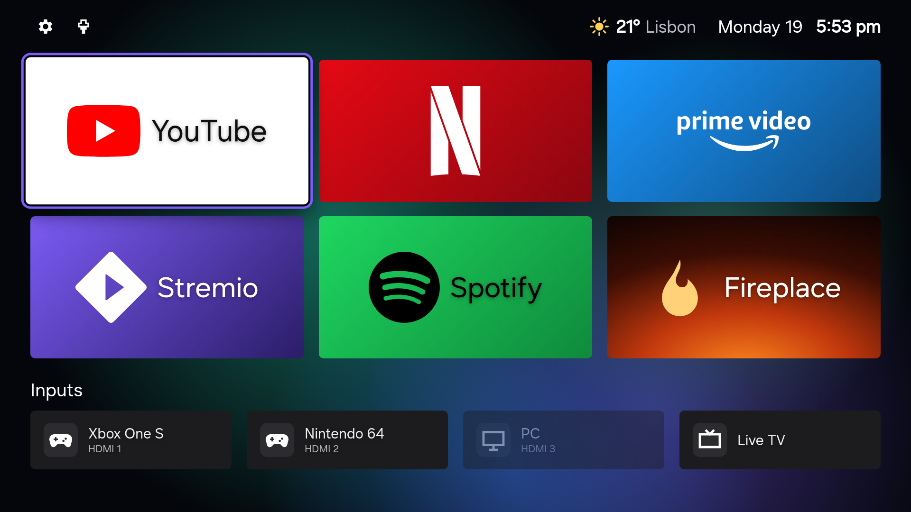
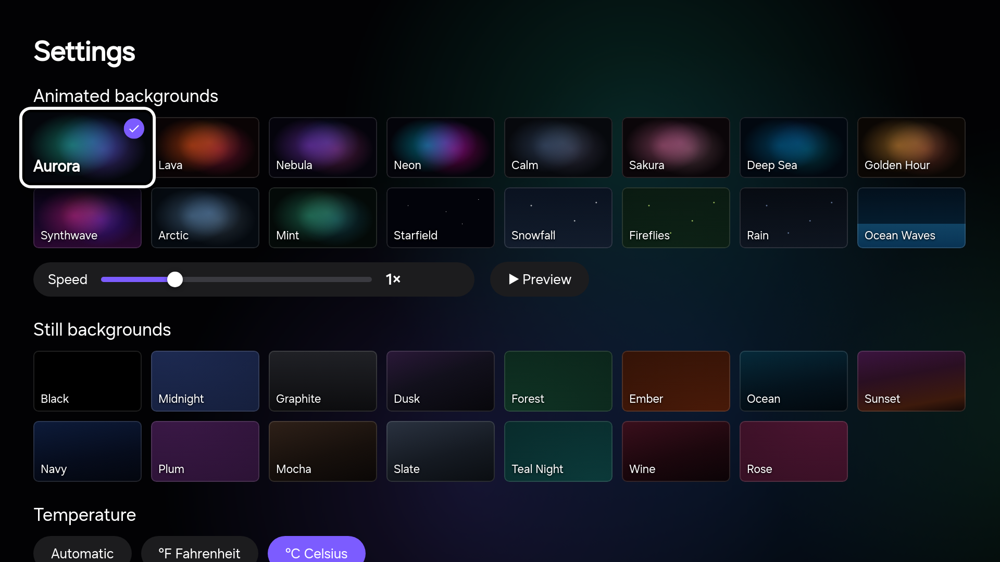
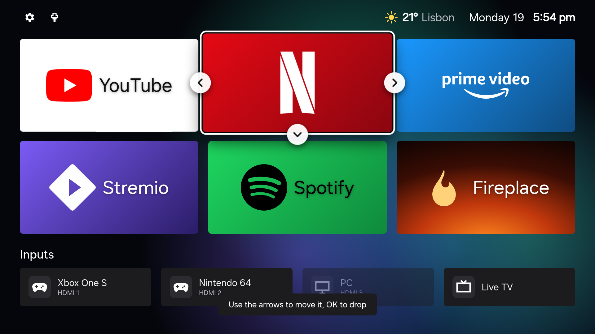
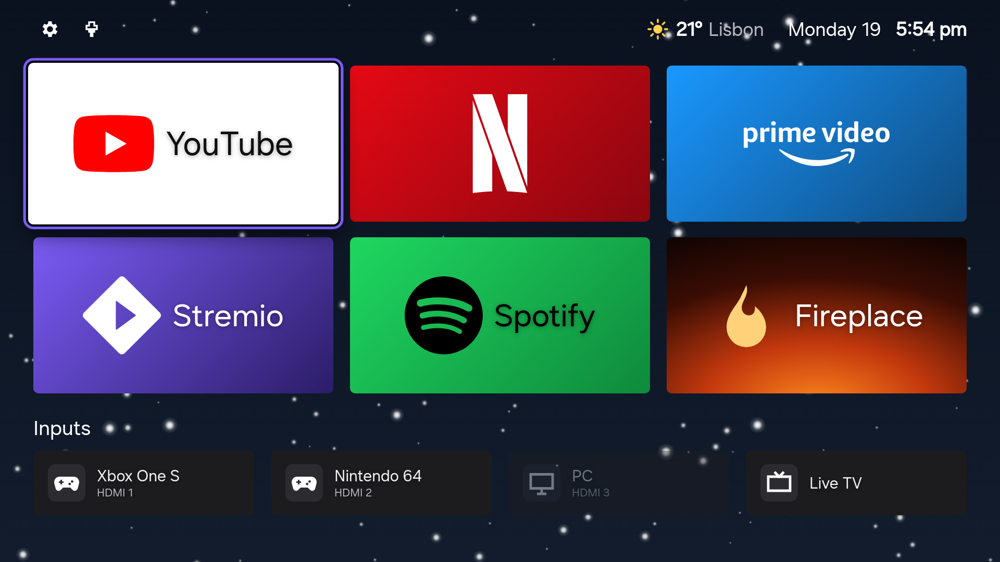
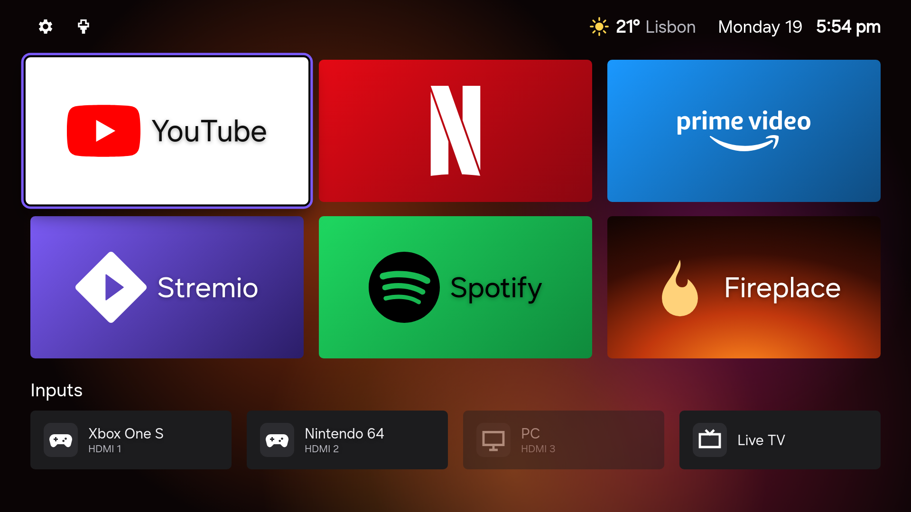

# AeroTizen

**A clean, fast, ad-free home screen for Samsung Tizen TVs, plus the tools to debloat the TV from your computer.**



## Motivation

A new Samsung TV is a great panel wrapped in a cluttered interface: sponsored rows, "Top Picks
for You", Samsung TV Plus autoplaying at boot, a viewing tracker (ACR) on by default, and
hundreds of preinstalled background components. Android TV owners can swap the launcher and
debloat over ADB. Samsung owners can't: Tizen has no launcher API, no shell, and almost no
tooling outside Samsung's heavyweight SDK.

AeroTizen is the closest thing to that for Tizen. It installs a minimal home screen as a regular
app, makes it the first thing you see, and gives you a small command-line tool to clean up the
rest: no Tizen Studio, no rooting, nothing to flash.

## What you get

**On the TV**
- A 3-across grid of your apps with official logos, and your inputs underneath
- Starts at power-on and comes back when you press Home ([details](#limits))
- Hold OK on a tile to move it
- Inputs show every HDMI port with the connected device's name (renameable)
- 31 backgrounds, 16 animated (adjustable speed, live preview)
- Clock, weather and city in the top bar (°F/°C, 12/24-hour, several date styles)
- Network status (Ethernet, Wi-Fi strength, offline)
- Fireplace tile: a fireplace video, with a built-in animated fire as fallback
- Settings: choose which installed apps appear, open the Samsung app store, or hand
  control back to Samsung Home

**From your computer** (`aerotizen` CLI)
- Finds the TV on your network and pairs as a remote
- Talks to the TV's developer port in pure Python (no Samsung SDK, works on macOS/Linux/Windows)
- Creates Samsung signing certificates for your TV (one Samsung account sign-in)
- Signs and installs any app (`.wgt`), including the launcher
- Lists installed apps and flags bloat; removes it where the firmware allows

**Guides**
- [Settings to turn off](docs/settings.md) (ads, viewing-data tracking, autorun)
- [DNS blocklists](dns/) for Pi-hole, AdGuard Home or NextDNS

| Settings | Move a tile | Snowfall | Lava |
|---|---|---|---|
|  |  |  |  |

<sub>Device names and weather in the screenshots are examples.</sub>

## Tested on

| TV | Year | Firmware |
|---|---|---|
| Samsung 65" Crystal UHD **DU7200** (UN65DU7200FXZA) | 2024 | Tizen 9.0 |

Other 2020+ Samsung TVs should work; please [report your model](../../issues/new?template=model_report.yml).

## Setup

You need a computer on the same network as the TV, with Python 3.10+.

**1. Install the CLI**
```bash
pip install git+https://github.com/helalaou/AeroTizen
aerotizen discover
```

**2. Turn on Developer Mode** (once, on the TV)
1. Open **Apps**, then type `1 2 3 4 5` (use the remote's **123** button if it has no number keys).
2. Turn **Developer mode** on and set **Host PC IP** to your computer's IP. Press **OK**.
3. **Unplug the TV for a minute.** A normal power-off doesn't apply the change.
4. `aerotizen status` should show `developerMode=1`.

**3. Create certificates** (once per TV)
```bash
aerotizen certs
```
This opens Samsung's sign-in page. Certificates are saved to `~/.config/aerotizen/`.

**4. Install the launcher**
```bash
git clone https://github.com/helalaou/AeroTizen && cd AeroTizen
aerotizen install launcher
```
The TV now starts on AeroTizen. Press the gear for settings.

**Optional: clean up apps**
```bash
aerotizen apps        # what's installed, classified
aerotizen debloat     # pick what to remove
```

## Limits

Samsung doesn't allow third-party home screens or system changes, so some things are best-effort:

- **Home button:** a background service brings AeroTizen back within ~1–2 s. It works on boot,
  from Samsung Home and inside Netflix. Inside YouTube, Prime Video, Stremio and Spotify,
  Samsung doesn't report whether the app is on screen, so Home stays on Samsung's menu there.
  **Back** always returns to AeroTizen.
- **Uninstalling:** Tizen 6+ refuses removal of store and preinstalled apps over the developer
  port. Use **Apps → ⚙️ → Delete** on the TV. System apps (TV Plus, Gaming Hub) can only be disabled.
- **Resolution:** Samsung renders all apps at 1920×1080 and upscales to the panel; only video is native 4K.
- **Samsung's own UI** (menus, settings, ads in its screens) can't be modified; see the
  [settings guide](docs/settings.md) and [DNS lists](dns/) for what you can switch off.

## Contributing

This started as a fix for one TV. It would be great if people helped turn it into a better
experience for every Samsung TV, beyond the bloat and full-screen ads Tizen ships with.
Testing on your model is the most useful contribution. Ideas, fixes and new themes are all welcome.
See [CONTRIBUTING.md](CONTRIBUTING.md).

## Credits

- [LTvLauncher](https://github.com/leanbitlab-org/LtvLauncher): layout inspiration
- [Apps2Samsung](https://github.com/Apps2Samsung/Apps2Samsung) and [tizen-sdb](https://github.com/PatrickSt1991/tizen-sdb) (MIT): reference for the sdb protocol, certificate flow and signing
- [samsung-tizen-tv-debloat](https://github.com/ardazeytin/samsung-tizen-tv-debloat) (MIT): package safety rules
- [Simple Icons](https://simpleicons.org) (CC0): app logos; trademarks belong to their owners
- [Open-Meteo](https://open-meteo.com) and [ipapi](https://ipapi.co): weather and location

Not affiliated with Samsung. Use at your own risk.

## License

[MIT](LICENSE)
